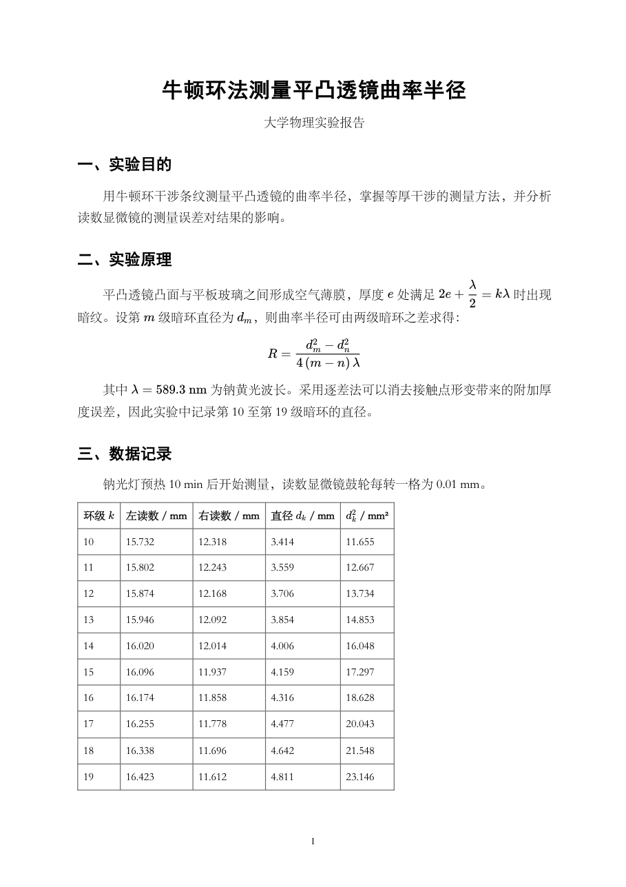
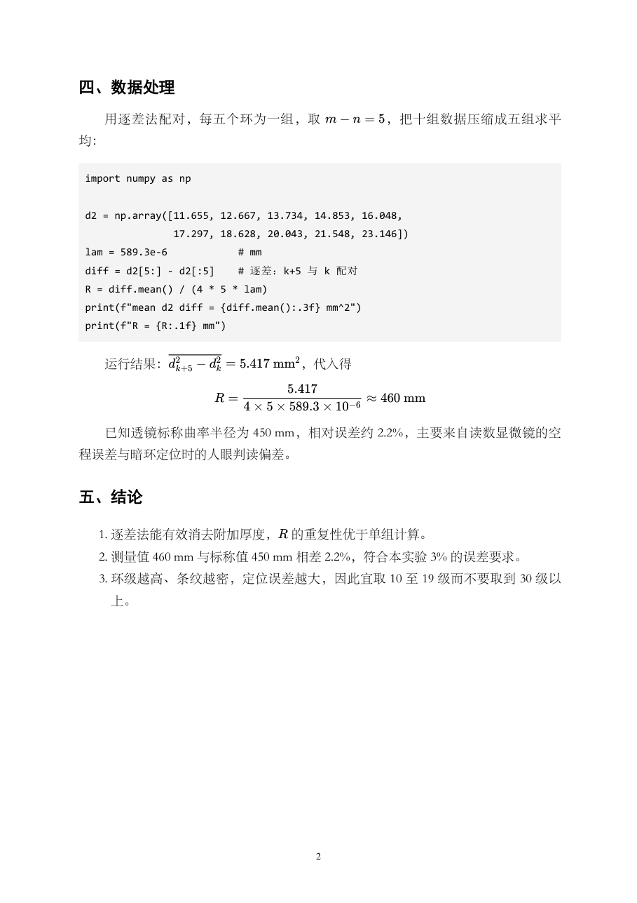

# md-to-pdf

[中文说明](README.zh-CN.md)

A **DSH skill** that turns a Markdown file — **Chinese or English**, LaTeX math and all — into a print-quality A4 PDF **fully offline**, without Microsoft Office, LibreOffice or a TeX distribution.

The layout language is detected from the text itself, so the same command typesets both languages correctly: Chinese gets 宋体 with 2-character first-line indent, English gets a Times-family serif, no indent and automatic hyphenation.

```
markdown-it  →  KaTeX (pre-rendered to HTML)  →  headless Chromium print  →  PyMuPDF page numbers
```

Formulas are real vector typesetting (not screenshots), and the same `.md` always produces the same `.pdf`.

**New here? → [QUICKSTART.md](QUICKSTART.md)** (install, self-check, three commands, troubleshooting).

---

## Features

- ✅ `\( … \)` / `\[ … \]` math rendered with KaTeX (fonts vendored, no network needed)
- ✅ **Bilingual typography**: Chinese (宋体/黑体, 2em indent) and English (Times family, no indent, `hyphens: auto`) from the same command — auto-detected, or forced with `MD2PDF_LANG=zh|en`
- ✅ A4, 1.72 line-height, justified, page numbers — identical for both languages
- ✅ Page numbers stamped after printing (Chromium has no `@page` margin boxes)
- ✅ Headings, tables, lists, code blocks; heading-level normalisation (`###` → `##`, `**bold line**` → `###`)
- ✅ One command, or drag-and-drop a `.md` onto a `.bat`
- ✅ Self-contained: `scripts/node_modules` ships with the repo — no `npm install`

## Requirements

| Need | Check |
|---|---|
| Node.js ≥ 18 | `node -v` |
| Python 3 + `pymupdf` (page numbers, previews) | `python -c "import pymupdf"` — install with `python3 -m pip install -r scripts/requirements.txt` |
| Microsoft Edge or Google Chrome | `MD2PDF_EDGE` env var if not in a standard location |
| 宋体 / 黑体 (SimSun / SimHei) | Windows built-in; on Linux swap the CSS font stack for Noto Sans CJK |
| A Latin serif for English | Times/Liberation/DejaVu Serif — one of them is on every Windows/Linux box |

## Quick start

```bash
./install.sh                      # Claude Code + Codex (+ DSH when ~/.dsh exists)
node scripts/md2pdf.js --doctor   # node / browser / python / CJK fonts, one table
```

```powershell
# Windows PowerShell
.\install.ps1
& ".\scripts\md2pdf.ps1" `
    -InputPath  "D:\work\report.md" `
    -OutputPath "D:\work\report.pdf" `
    -Title      "报告标题" `
    -Subtitle   "实 验 报 告"
```

macOS / Linux one-liner with page numbers:

```sh
./scripts/md2pdf.sh report.md report.pdf "Report title"
```

Or drag any `.md` onto `scripts\Drop-MD-Here.bat` — the PDF appears next to the source file.

Render-only (no page numbers):

```sh
node scripts/md2pdf.js input.md output.pdf "Title" "Subtitle"
```

English documents need no special flags — just run the same command:

```sh
node scripts/md2pdf.js paper.md paper.pdf "Newton's Rings" "Lab Report 4.18"
# -> html lang="en", Times-family serif, no first-line indent, hyphenation on

# mixed / ambiguous text: lock the layout language explicitly
MD2PDF_LANG=zh node scripts/md2pdf.js notes.md notes.pdf
MD2PDF_LANG=en node scripts/md2pdf.js notes.md notes.pdf
```

| | Chinese | English |
|---|---|---|
| Body font | SimSun / 宋体 | Times New Roman → Liberation Serif → DejaVu Serif |
| Headings | SimHei / 黑体 | Helvetica Neue → Arial → DejaVu Sans |
| First-line indent | 2em | none |
| Hyphenation | — | `hyphens: auto` + `<html lang="en">` |
| Soft line breaks | one paragraph per source line | standard Markdown merging |
| `###` headings | demoted to `##` only when the doc has no `##` at all | preserved |

Check that the toolchain is complete:

```sh
node scripts/md2pdf.js --selftest
```

Inspect the result (rasterise pages to PNG for a visual check):

```sh
python scripts/pdf_pages.py report.pdf preview 140
```

> **No Chromium?** On an Android phone's Ubuntu container there is no Edge/Chrome
> and snap cannot run; WeasyPrint is not a substitute either — its `ex`-unit maths
> makes inline fractions overlap the body text. Use the bundled Typst fallback
> instead: one 48 MB static binary, LaTeX-class maths, fully offline.
> `typst compile scripts/typst-template.typ /sdcard/report.pdf` — see the "No Chromium" section of SKILL.md.

## Examples

Both files in `examples/` were rendered by this repo — page numbers included, nothing retouched:

| Chinese lab report — A4, 2 pages | English lab note — A4, 2 pages |
|---|---|
|  |  |



```bash
node scripts/md2pdf.js examples/zh-report.md out.pdf "牛顿环法测量平凸透镜曲率半径" "大学物理实验报告"
python scripts/add_pageno.py out.pdf
```

The committed PDFs are the exact output of those two sources, and `tests/test_md2pdf.py` asserts their page geometry, extractable text, embedded fonts and stamped page numbers — a layout regression fails `python -m unittest` instead of shipping.

**Math delimiters:** `\( … \)` inline, `\[ … \]` display. `$…$` is *not* rendered: the build prints a warning naming the span, because silently emitting `$E=mc^2$` as text is worse than saying so.

## Layout in this repo

```
QUICKSTART.md             buyer-facing: install, doctor, three commands, troubleshooting
install.sh / install.ps1  install into ~/.claude/skills and ~/.agents/skills
LICENSE                   MIT
agents/openai.yaml        Codex metadata (display name, implicit-invocation policy)
SKILL.md                  skill manifest + decision table + 30 hard-won pitfalls
examples/                 two A4 reports (source .md + the exact rendered PDF)
tests/                    unittest suite: page geometry, fonts, page numbers, CLI regressions
docs/img/                 the screenshots used in this README
scripts/
  md2pdf.js               md → KaTeX → HTML → headless Chromium → PDF (+ --doctor)
  md2pdf.sh               macOS / Linux entry point: finds node, then stamps page numbers
  md2pdf.ps1              one-command wrapper, auto-detects node / python / browser
  add_pageno.py           PyMuPDF page numbers
  pdf_pages.py            PDF → PNG for visual verification
  typst-template.typ      Chinese A4 report template for hosts without Chromium
  typst-template-en.typ   English A4 report template for the same hosts
  Drop-MD-Here.bat        drag-and-drop entry point
  requirements.txt        Python deps of add_pageno.py / pdf_pages.py (pymupdf)
  package.json, node_modules/   vendored katex + markdown-it
```

## Use it as a DSH skill

Clone this repo as a skill folder and let the harness discover it:

```powershell
git clone https://github.com/ZihanZhang114514/md-to-pdf "$env:USERPROFILE\.dsh\skills\md-to-pdf"
```

or point the filesystem skill provider at a custom root:

```yaml
customSkillDirs:
  - D:\dsh_skills
```

A skill folder is discovered only as `<root>/<name>/SKILL.md` — nested manifest files are ignored.

## Other agents (Claude Code, Codex)

The repo follows the [Agent Skills](https://agentskills.io) open standard, so the same folder works in other harnesses — only the install path changes:

| Host | Skill directory | Invoke |
|---|---|---|
| DSH | `~/.dsh/skills/md-to-pdf/` (or a root registered with `customSkillDirs`) | automatic |
| Claude Code | `~/.claude/skills/md-to-pdf/` or `<repo>/.claude/skills/md-to-pdf/` | automatic, or `/md-to-pdf` |
| Codex | `~/.agents/skills/md-to-pdf/` or `<repo>/.agents/skills/md-to-pdf/` | automatic, or `$md-to-pdf` |

```bash
# Claude Code, personal
git clone https://github.com/ZihanZhang114514/md-to-pdf ~/.claude/skills/md-to-pdf

# Codex, personal
git clone https://github.com/ZihanZhang114514/md-to-pdf ~/.agents/skills/md-to-pdf
```

Things worth knowing before you point another agent at it:

- **Browser lookup is cross-platform.** `md2pdf.js` checks `MD2PDF_EDGE`, the standard Windows/macOS/Linux install paths, then `$PATH`. If nothing is found it exits `3` with the Typst fallback spelled out — never a silent empty PDF.
- **Windows-only helpers.** `md2pdf.ps1` and `Drop-MD-Here.bat` are Windows conveniences; on macOS/Linux call `node scripts/md2pdf.js` directly.
- **No Chromium at all?** Use the Typst templates (see the section above); they need neither Node nor a browser.
- **Frontmatter carries both keys.** `when_to_use` is the Agent Skills/Claude Code field, `whenToUse` is the DSH extension. Hosts ignore keys they don't know. Note that *uploading* to claude.ai or packaging with the Skills API is stricter — strip the DSH-only key first, or packaging fails with `Unexpected key(s) in SKILL.md frontmatter`.
- **Delivery is host-specific.** The SKILL.md delivery step says "hand the PDF path to the user"; DSH spells that `present(...)`, other agents just print the absolute path.

## How it compares with the other engines

| Engine | Chinese | Math | When |
|---|---|---|---|
| **KaTeX + headless Chromium** (this repo) | good | excellent | `.md` → PDF, the default |
| Word COM (`python-docx` + OMML) | best | good (editable formulas) | user wants an editable `.docx` |
| LibreOffice headless | fair | fair (OMML spacing degrades) | no Office, other formats → PDF |
| XeLaTeX + ctex | excellent | excellent | academic typesetting, heavy install |
| **Typst** (single static binary) | excellent (Noto CJK) | excellent | **no Chromium: Android / Linux container** |

Measured on the same Chinese lab report: **Word ≈ KaTeX > XeLaTeX > LibreOffice**. Do not install a 4 GB TeX distribution just to print formulas.

## Gotchas

See the "踩坑清单" section of [SKILL.md](SKILL.md) — including why math must be extracted *before* markdown parsing, why display equations need a standalone placeholder, why `$Input`/`$Output` must never be PowerShell parameter names, and why headless Chromium's stderr output kills a strict PowerShell script, why the line-oriented layout shreds English paragraphs, and why `###` must not be demoted in a document that already has real heading levels.
