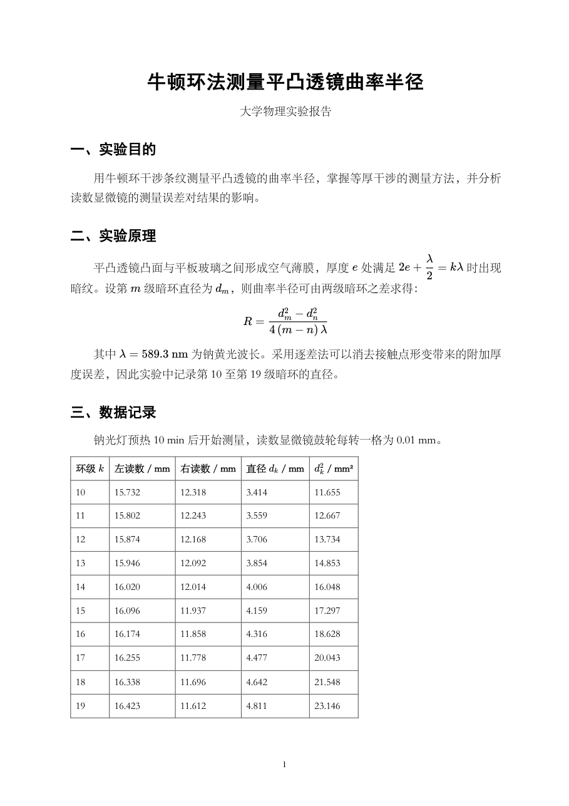
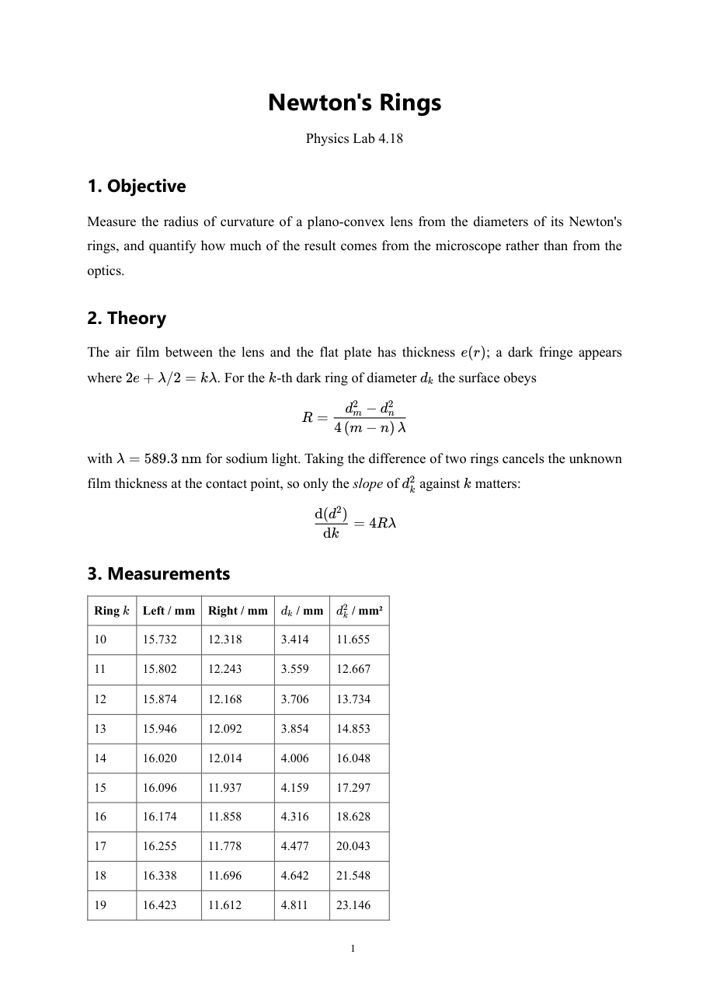
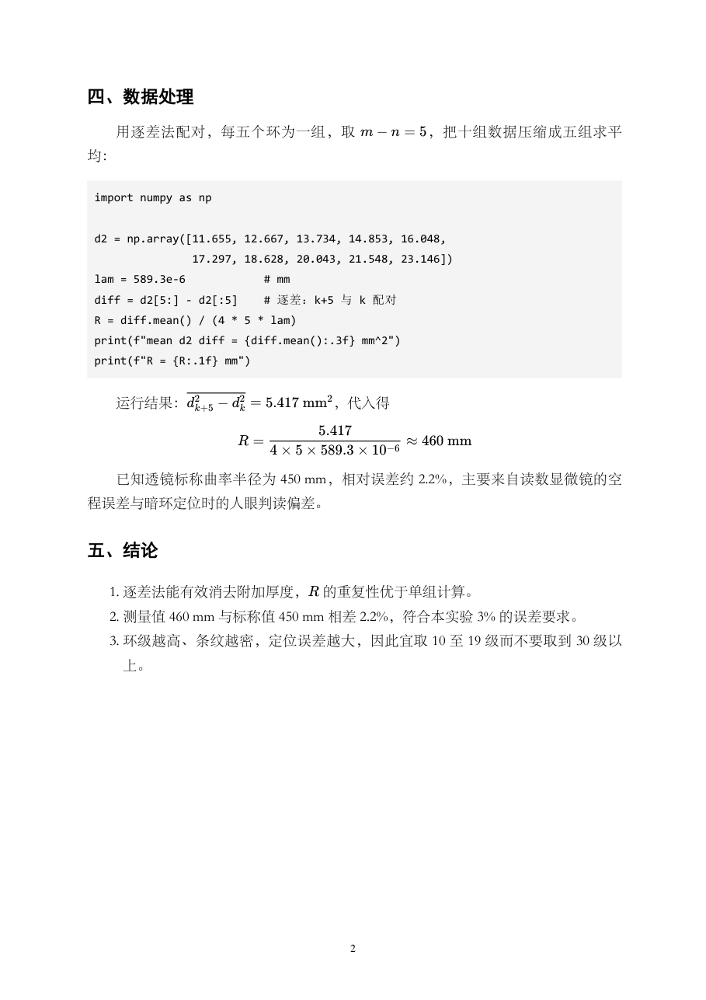

# md-to-pdf

[English](README.md)

一个 **DSH skill**：把 Markdown 变成可交付的 A4 打印级 PDF —— **中文、英文都行**，公式也在。全程离线，不需要 Microsoft Office、LibreOffice 或 LaTeX。

```
markdown-it  →  KaTeX（公式预渲染成 HTML）  →  无头 Chromium 打印  →  PyMuPDF 补页码
```

公式是真正的矢量排版（不是截图），同一份 `.md` 反复出同一份 `.pdf`。

**第一次用？看 [QUICKSTART.md](QUICKSTART.md)**（安装、自检、三条命令、故障表）。

**排版语言自动判断**：同一个命令，中文走宋体 + 2 字首行缩进，英文走 Times 系 + 不缩进 + 自动断词。

---

## 能力

- ✅ **中英双语排版**：中文（宋体/黑体、2em 缩进）与英文（Times 系、不缩进、`hyphens: auto`）同一命令搞定；自动判断，也可用 `MD2PDF_LANG=zh|en` 强制
- ✅ 版面一致：A4、1.72 行距、两端对齐、页码 —— 两种语言相同
- ✅ `\( … \)` / `\[ … \]` 公式用 KaTeX 渲染（字体随包携带，不联网）
- ✅ 标题、表格、列表、代码块；标题层级规范化（`**粗体整行**` → `###`）
- ✅ 一条命令，或把 `.md` 拖到 `.bat` 上
- ✅ 自带 `scripts/node_modules` —— 不需要 `npm install`

## 环境要求

| 需要 | 检查 |
|---|---|
| Node.js ≥ 18 | `node -v` |
| Python 3 + `pymupdf`（页码、预览） | `python -c "import pymupdf"`，装：`python3 -m pip install -r scripts/requirements.txt` |
| Microsoft Edge 或 Google Chrome | 不在默认路径就设 `MD2PDF_EDGE` |
| 宋体 / 黑体（中文） | Windows 自带；Linux 换成 Noto Sans/Serif CJK |
| 一个拉丁衬线体（英文） | Times / Liberation / DejaVu Serif 任选其一，各系统都有 |

## 快速上手

```bash
./install.sh                      # 装进 Claude Code + Codex（有 ~/.dsh 时也装）
node scripts/md2pdf.js --doctor   # 一张表看清 node / 浏览器 / python / 中文字体
```

```powershell
# Windows PowerShell
& ".\scripts\md2pdf.ps1" `
    -InputPath  "D:\work\report.md" `
    -OutputPath "D:\work\report.pdf" `
    -Title      "报告标题" `
    -Subtitle   "实 验 报 告"
```

macOS / Linux 一行命令（自动补页码）：

```sh
./scripts/md2pdf.sh report.md report.pdf "报告标题"
```

或者把任意 `.md` 拖到 `scripts\Drop-MD-Here.bat` 上，PDF 生成在源文件旁边。

只要渲染、不要页码：

```sh
node scripts/md2pdf.js input.md output.pdf "标题" "副标题"
```

英文文档不用加任何参数，同一条命令：

```sh
node scripts/md2pdf.js paper.md paper.pdf "Newton's Rings" "Lab Report 4.18"
# -> html lang="en"、Times 系、无首行缩进、开启断词

# 中英混排、判断不准时，锁定排版语言
MD2PDF_LANG=zh node scripts/md2pdf.js notes.md notes.pdf
MD2PDF_LANG=en node scripts/md2pdf.js notes.md notes.pdf
```

| | 中文 | 英文 |
|---|---|---|
| 正文 | 宋体（SimSun） | Times New Roman → Liberation Serif → DejaVu Serif |
| 标题 | 黑体（SimHei） | Helvetica Neue → Arial → DejaVu Sans |
| 首行缩进 | 2em | 无 |
| 断词 | 不需要 | `hyphens: auto` + `<html lang="en">` |
| 软换行 | 一行一段（中文实验报告习惯） | 按标准 Markdown 合并 |
| `###` 标题 | 只有整篇没有 `##` 时才降级 | 保留原层级 |

检查工具链是否完整：

```sh
node scripts/md2pdf.js --selftest
```

看产物（PDF 转 PNG 人眼核对）：

```sh
python scripts/pdf_pages.py report.pdf preview 140
```

## 效果示例

`examples/` 里的两份文档都由本仓库渲染，页码也是真的补上去的，没有后期处理：

| 中文实验报告（A4，2 页） | 英文实验笔记（A4，2 页） |
|---|---|
|  |  |



```bash
node scripts/md2pdf.js examples/zh-report.md out.pdf "牛顿环法测量平凸透镜曲率半径" "大学物理实验报告"
python scripts/add_pageno.py out.pdf
```

仓库里的 PDF 就是这两份源文件的真实产物；`tests/test_md2pdf.py` 会断言它们的页面尺寸、可提取文本、字体嵌入和页码，排版回退会让 `python -m unittest` 失败，而不是被发出去。

**公式定界符**：行内 `\( … \)`，行间 `\[ … \]`。`$…$` **不渲染**——构建时会打印一行警告并指出是哪一段，因为把 `$E=mc^2$` 当正文印出来比说明白更糟。

## 仓库结构

```
QUICKSTART.md             买家向：安装、自检、三条命令、故障排查
install.sh / install.ps1  装进 ~/.claude/skills 与 ~/.agents/skills
LICENSE                   MIT
agents/openai.yaml        Codex 元数据（显示名、隐式调用策略）
SKILL.md                  技能清单 + 选型表 + 30 条实测坑
examples/                 两份 A4 示例（源 .md + 渲染出的 PDF 原件）
tests/                    unittest：页面尺寸、字体、页码、CLI 回归
docs/img/                 本 README 用到的截图
scripts/
  md2pdf.js               md → KaTeX → HTML → 无头 Chromium → PDF（含 --doctor）
  md2pdf.sh               macOS / Linux 入口：自己找 node，跑完补页码
  md2pdf.ps1              一键封装，自动找 node / python / 浏览器
  add_pageno.py           PyMuPDF 补页码
  pdf_pages.py            PDF → PNG 用于校验
  Drop-MD-Here.bat        拖放入口
  requirements.txt        Python 依赖（add_pageno.py / pdf_pages.py 用的 pymupdf）
  typst-template.typ      中文 A4 模板（给没有 Chromium 的机器）
  typst-template-en.typ   英文 A4 模板（同上）
  package.json, node_modules/   随包携带的 katex + markdown-it
```

## 没有 Chromium 的时候

Android 手机上的 Ubuntu 容器里没有 Edge/Chrome，snap 也跑不起来；WeasyPrint 也不是替代品（它按 `ex` 换算 MathJax 的 SVG，行内分式会压住正文）。这种情况用自带的中英文 Typst 模板：一个 48 MB 静态二进制，数学排版与 LaTeX 同级，全程离线。

```sh
typst compile scripts/typst-template.typ    /sdcard/report-zh.pdf
typst compile scripts/typst-template-en.typ /sdcard/report-en.pdf
```

细节见 `SKILL.md` 的「没有 Chromium 时：Android / Linux 容器路线」。

## 当作 DSH skill 使用

把仓库克隆成 skill 目录，交给 harness 自动发现：

```powershell
git clone https://github.com/ZihanZhang114514/md-to-pdf "$env:USERPROFILE\.dsh\skills\md-to-pdf"
```

或者给文件系统 skill provider 指一个自定义根目录：

```yaml
customSkillDirs:
  - D:\dsh_skills
```

只有 `<根目录>/<名字>/SKILL.md` 这种结构会被发现，嵌套的清单文件会被忽略。

## 其他 agent（Claude Code、Codex）

本仓库遵循 [Agent Skills](https://agentskills.io) 开放标准，同一个目录换到别家也能用，差别只在装到哪：

| 宿主 | 技能目录 | 调用 |
|---|---|---|
| DSH | `~/.dsh/skills/md-to-pdf/`（或用 `customSkillDirs` 注册的根目录） | 自动 |
| Claude Code | `~/.claude/skills/md-to-pdf/` 或 `<仓库>/.claude/skills/md-to-pdf/` | 自动，或 `/md-to-pdf` |
| Codex | `~/.agents/skills/md-to-pdf/` 或 `<仓库>/.agents/skills/md-to-pdf/` | 自动，或 `$md-to-pdf` |

```bash
# Claude Code（个人级）
git clone https://github.com/ZihanZhang114514/md-to-pdf ~/.claude/skills/md-to-pdf

# Codex（个人级）
git clone https://github.com/ZihanZhang114514/md-to-pdf ~/.agents/skills/md-to-pdf
```

搬过去之前值得知道的几点：

- **浏览器查找是跨平台的**：`md2pdf.js` 依次查 `MD2PDF_EDGE`、Windows/macOS/Linux 的标准安装路径、再扫 `$PATH`。一个都没找到时以退出码 3 结束，并明确提示改用 Typst，不会静默产出空 PDF。
- **Windows 专属的两个包装**：`md2pdf.ps1` 和 `Drop-MD-Here.bat` 只在 Windows 有用，macOS/Linux 直接调 `node scripts/md2pdf.js`。
- **完全没有 Chromium**：走 Typst 模板（见上一节），连 Node 都不需要。
- **frontmatter 两个键并存**：`when_to_use` 是 Agent Skills / Claude Code 的规范字段，`whenToUse` 是 DSH 扩展；不认识的宿主会忽略多余键。但**上传到 claude.ai 或用 Skills API 打包时校验更严**，要先删掉 DSH 专属键，否则报 `Unexpected key(s) in SKILL.md frontmatter`。
- **交付方式随宿主**：SKILL.md 里写的是「把 PDF 路径交给用户」，DSH 用 `present(...)`，其他 agent 直接给绝对路径即可。

## 和其他引擎对比

| 引擎 | 中文 | 公式 | 何时用 |
|---|---|---|---|
| **KaTeX + 无头 Chromium**（本仓库） | 好 | 极好 | `.md` → PDF 的首选 |
| **Typst**（单文件二进制） | 极好 | 极好 | 没有 Chromium 的容器 / Android |
| Word COM（`python-docx` + OMML） | 最好 | 好（公式可编辑） | 用户要可编辑的 `.docx` |
| LibreOffice headless | 一般 | 一般（OMML 间距变差） | 无 Office 时转其它格式 |
| XeLaTeX + ctex | 极好 | 极好 | 学术排版，安装重 |

同一个中文报告实测：Word ≈ KaTeX > XeLaTeX > LibreOffice。**不要为了公式去装 4 GB 的 TeX。**

## 已知问题

见 [SKILL.md](SKILL.md) 的「踩坑清单」30 条，包括：为什么公式要在 markdown 解析**之前**抽出、独立公式为什么要用独占一段的占位符、为什么 PowerShell 参数不能叫 `$Input`、无头 Chromium 的 stderr 为什么会让严格的脚本中断、英文段落为什么会被拆碎，以及没有 Chromium 的机器上该用什么。
